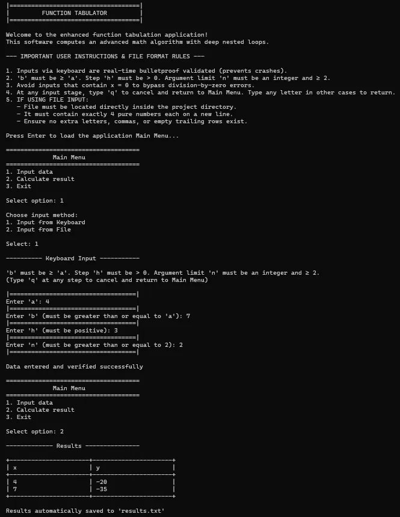
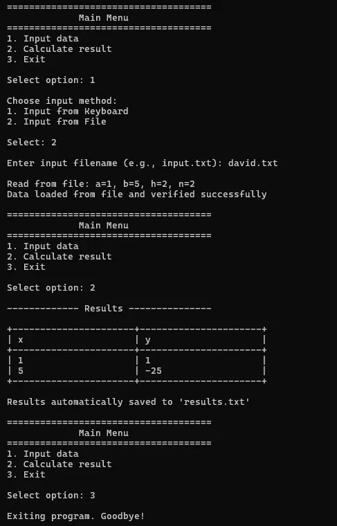
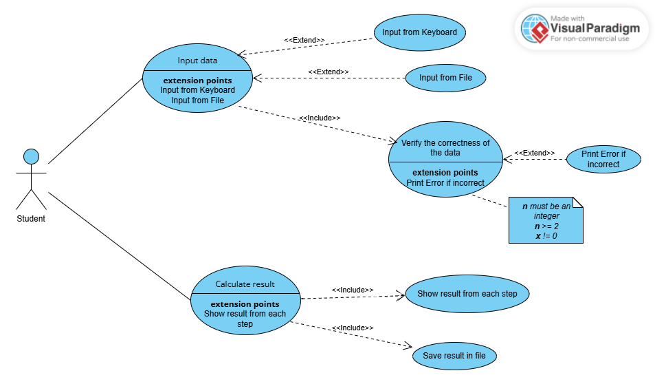
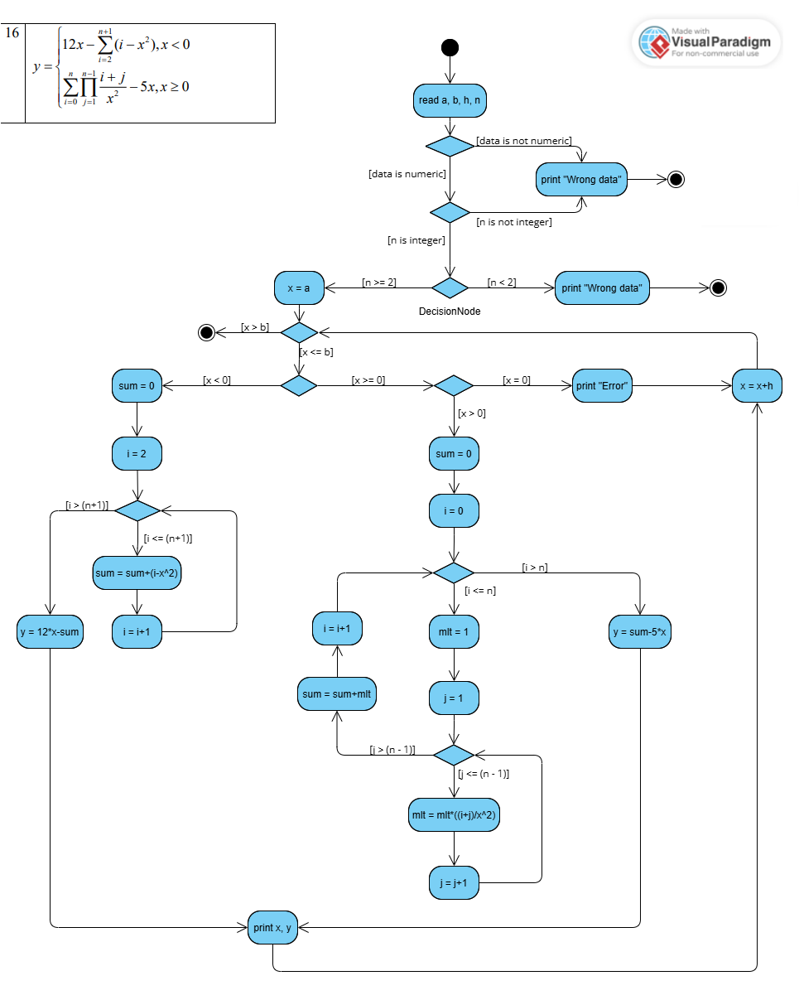
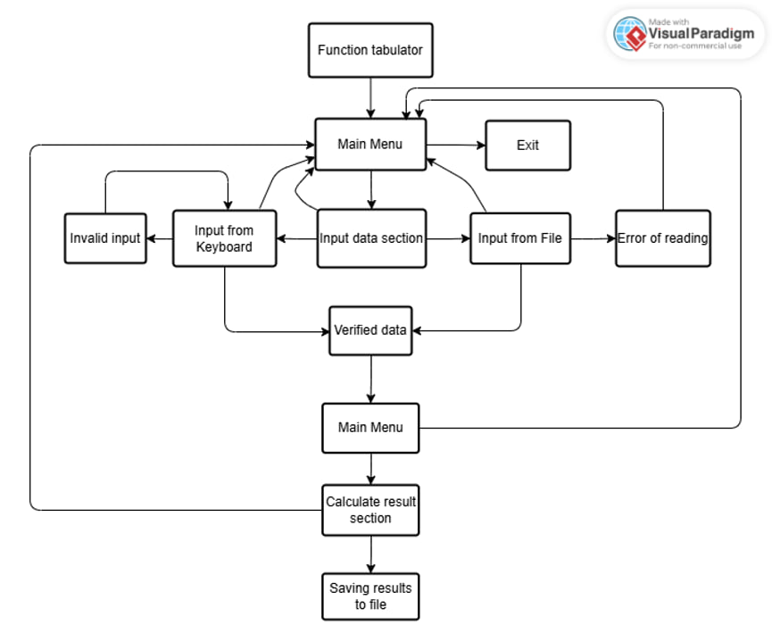

# Function Tabulator

A C++ console application that tabulates a piecewise-defined function over the interval [a, b] with a step size of h using Formula.
The project includes source code, UML and Use Case diagrams, a flowchart, usage scenarios, and reports for laboratory assignments 1 and 2.

## Author
- Student: Sokurenko David
- University: National Technical University «Kharkiv Polytechnic Institute»
- Group: KN-226e
- Year: 2026

## Formula
```
y = 12x − Σ(i=2..n+1) (i − x²),            x < 0
y = Σ(i=0..n) Π(j=1..n−1) (i+j)/x² − 5x,   x ≥ 0
```

## Input data
| Parameter | Description | Requirement |
|----------|------|--------|
| a | Starting value of x | Number |
| b | End value of x | Number, b ≥ a |
| h | Step size | Number, h > 0 |
| n | Loops limit | Integer, 2 ≤ n ≤ 10000 |

The value x = 0 is not calculated (division by zero); an error message is written to the results file for it.

## Main Menu
1. Input data (from keyboard or file)
2. Calculate result
3. Exit

When entering data via the keyboard, the letter `q` cancels the input and returns you to the main menu.

## Input from file
The file must be located in the same folder as the program and contain 4 numbers, each on a new line: a, b, h, n. Example: [input.txt](input.txt).

## Results
A table of x and y values ​​is displayed in the console (for very big amount of results showing the first and last steps, as well as every 1000th step). All results are automatically saved to a file `results.txt`.

## Example of program work

### Keyboard input


### File input


## Diagrams and Modeling

### Lab №1
**Use Case Diagram**



**Activity Diagram**



### Lab №2
**Flowchart (screen transition diagram)**



**Use cases:** [docs/use_case_scenarios.md](docs/use_case_scenarios.md)

## Reports
- [Lab. №1](docs/reports/Report_Sokurenko_226e_Lab1.docx)
- [Lab. №2](docs/reports/Report_Sokurenko_226e_Lab2.docx)

## Assembly and startup
The program uses `Windows.h`, so it runs on Windows (Visual Studio or MinGW):
```
g++ src/main.cpp -o tabulator.exe
tabulator.exe
```

## Technologies and Tools
C++ (Visual Studio), Visual Paradigm
